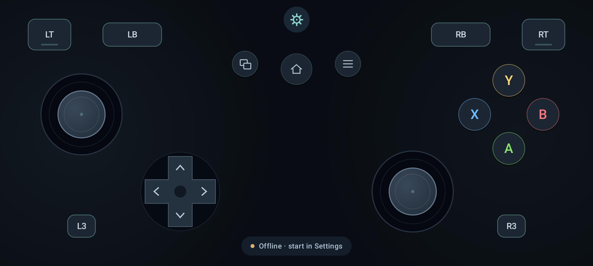

# CraftController — Android Prototype

**Version: 0.7.1-prototype · build 9 · Android 8.0+**

[Download prereleases](https://github.com/Unknown27s/craftcontroller/releases) ·
[Website](https://unknown27s.github.io/craftcontroller/)



*Controller screenshot from the Android emulator. Phone and DSU Manager interoperability remain unverified.*

Status: initial implementation. Physical-phone and DSU Manager interoperability
have not yet been validated. This is not a production release.

The current 0.7 revision makes QR scanning actually connect: it restarts the
foreground server that the camera paused, saves the PC endpoint, and immediately
sends the DSU version announcement over UDP from the bound listener socket. The
scanner now shows live subscriber state. A packet-capture comparison against the
original app also fixed the controller slot: the Manager subscribes to slot 1,
so 0.7.1 accepts and sends slot 1 instead of slot 0. Physical-phone and DSU
Manager interoperability still need verification; a subscriber count is not
proof that Windows created a gamepad or that a game received input. See
[0.7 notes](specs/revision-0.7.md), [0.7.1 notes](specs/revision-0.7.1.md),
[0.6 notes](specs/revision-0.6.md) and the
earlier [connection safeguards](specs/revision-0.5.1.md). The earlier
[0.1 validation](specs/validation.md) does not validate the current interface or
DSU Manager integration.

**Receiver decision:** reuse the existing Windows **DSU Manager**. No new PC
connector is being built. The phone now announces itself over UDP; whether a
given Manager version subscribes and produces Windows input remains unverified.

## Goal

Build an independent Android controller with a custom UI that sends button,
joystick, touch, and motion data using the DSU/cemuhook UDP protocol.
No accounts, hosted backend, or dependency on the original developer's services.

## Documents

- [Project plan](specs/dsu-controller.spec.md): scope, requirements, phases, and tests.
- [Important notes](IMPORTANT-NOTES.md): compatibility risks and engineering cautions.
- [Controller-app research](docs/controller-research.md): product comparison,
  customization lessons, emulation layers, primary sources and roadmap.
- [Receiver integration specification](specs/craftcontroller-receiver.spec.md):
  implemented helpers, pairing blocker and acceptance criteria for later.
- [Public research page](docs/research.html): browser-friendly summary for Pages.
- [Manager QR findings](docs/manager-qr-findings.md): decoded official example,
  observed URI format and remaining post-scan protocol gap.

## Implementation

- Kotlin / Jetpack Compose, Android 8.0+ (API 26).
- App: **CraftController**, `io.github.unknown27s.dsucontroller` (retained for updates).
- Independent JVM `core` module: DSU 1001 codec and coroutine-based UDP server.
- One controller slot, D-pad, ABXY, shoulders/triggers, two sticks, stick-click
  buttons, Share / Start / Home. Triggers currently report digital 0/255 pressure.
- Dedicated gamepad, grouped Settings and Layout Studio screens.
- Four built-in screen presets (Standard, Compact, Left-hand and Right-hand),
  plus one saved custom layout. Presets do not emulate different hardware protocols.
- On-phone layout editor: move, resize and hide buttons/sticks; save, discard with
  confirmation, or reset. Four accent colors and optional button haptic feedback.
- Local port, stick dead zone, layout, color, and synthetic identity persistence.
- Connected D-pad edits as one unit; version-1 four-part layouts migrate locally.
- Optional floating sticks, four/eight-way D-pad, sticky D-pad and control contrast.
- Connection, Controls, Appearance and Advanced settings; QR/manual entry beside
  the server controls in landscape, with technical details in Advanced.
- Windows **PC setup** screen for your existing DSU Manager: phone address/port,
  explicit refresh/copy/share, subscriber status, official help and driver warning.
- **Scan QR code** reads the documented Manager URI with an on-device camera;
  manual entry is available without camera permission. Review and Save endpoint
  stores a PC address/port, not a pairing session. Forget removes the saved target.
- Foreground only: transient focus loss clears input without dropping UDP;
  pause, default-network/address changes, or Stop stop UDP and clear input.
  Restart explicitly after returning from another app.
- Full-screen play with a small Settings gear; server controls and QR scanning
  live in Settings. Xbox-style offset sticks, colored ABXY and an eight-way
  sliding D-pad. Local control feedback works even while the server is offline.
- Motion, DSU touchpad data, rumble, multiple profiles, layout import/export,
  button remapping, and background streaming are **not implemented**.

No accounts, hosted services, analytics, copied app source, or proprietary assets.
Project license remains undecided; no redistribution license is granted here.

## Build and test

Use JDK 17 and Android SDK platform 36 / build-tools 36.0.0. Set `ANDROID_HOME`
to your SDK directory (or configure `sdk.dir` in untracked `local.properties`).

Package only, without running tests:

```sh
./gradlew :app:assembleDebug
```

Broad test suites/lint remain deferred by request; 0.7 builds without running
the full suites. The full existing tasks can be used later:
`./gradlew :core:test :app:testDebugUnitTest :app:lintDebug`.

Debug APK: `app/build/outputs/apk/debug/app-debug.apk`.
Website download: `docs/downloads/craftcontroller-debug.apk`.
Debug signing is for local testing, not distribution. No phone is installed to
automatically by building.

## Android builds and repository releases

Workflow: [Android APK and GitHub Release](https://github.com/Unknown27s/craftcontroller/actions/workflows/build.yml).

- App-source pushes and pull requests build an APK artifact. Tests/lint are off
  unless explicitly selected in a manual run.
- To publish: **Actions → Android APK and GitHub Release → Run workflow** on
  `main`, enable **publish**, and leave **run_checks** off for a package-only run.
- Alternatively, push a tag matching the built version name, currently
  `v0.7.1-prototype`. A mismatched tag fails instead of publishing the wrong version.
- Publishes a GitHub **prerelease** with a versioned APK, SHA-256 checksums and
  version metadata. Existing release assets are never overwritten automatically.
- Before the next release, increase both `versionName` and `versionCode` in
  `app/build.gradle.kts` (current: **0.7.1-prototype**, **9**).

CI APKs use temporary debug signing keys. They may not update over the local APK
or another CI run; uninstalling to resolve a signing conflict deletes saved app
data. No persistent/production signing key has been configured or uploaded.
The older Pages download is a local build; use each download's own checksum.

Rollback: remove a bad prerelease with `gh release delete TAG --yes` (preserves
the source tag). Do not overwrite a published APK; fix it and publish a new
version/code. This does not uninstall APKs already downloaded to phones.

## Try it on a trusted LAN

1. Install the debug APK on your phone and keep both devices on the same LAN.
2. Open **PC setup** for phone IPv4 addresses and UDP port (default 26760).
   Start the server explicitly. A listener is not a paired Windows controller.
3. Use your existing Windows DSU Manager. The published release found during
   research is **v0.6.2**; the user's installed version is unknown. Open
   **Settings → Connection**, scan the Manager QR, and the app sends the DSU
   version announcement automatically. Watch the subscriber count: zero means
   the PC has not subscribed; above zero means data packets are being delivered.
   A generic receiver's direct DSU-source option is not proof that DSU Manager
   accepts the same setup.
4. For an independent standard-DSU check from the PC:

   ```sh
   python3 tools/probe.py PHONE_IPV4 --seconds 15
   ```

5. Press/release buttons, drag both sticks, and watch the probe output. Test
   app switching and screen lock: the server must stop and input must reset.

DSU is not a system-wide gamepad driver. DSU Manager may need platform-specific
virtual-controller permissions/drivers; this project does not configure those.
Do not expose this unauthenticated UDP listener to the internet.

## Protocol bounds and evidence

- Standard version, controller-info and controller-data messages only.
- Up to eight endpoint subscriptions; expire five seconds after the last valid
  matching registration. Slots 1–3 are reported disconnected.
- Send cadence target: at most approximately 60 packets/s per subscriber, not a
  measured phone delivery rate. Global request processing limit: 100 datagrams/s.
- IPv4 listener only; default-network changes stop it. Hotspot/VPN behavior needs
  physical-device testing. No hardcoded Wi-Fi interface name.
- Parser validates magic, version, declared length, CRC, type and payload bounds.
- Tests include fixed Python `struct`/`zlib` version fixtures, packet offsets,
  malformed inputs, and real localhost UDP exchange/expiry/bind failure.
- Public wire-format reference: <https://v1993.github.io/cemuhook-protocol/>.
  It was used as documentation, not copied implementation code.
- Pending: physical multitouch/cancellation checks, accessibility review,
  DSU Manager tests, sensor-axis validation, latency and battery measurements.

The specification is the longer-term plan, not a claim that all requirements
have been implemented or accepted.

## Customize your controller

Tap the **Settings gear → Controls**, select a controller preset, then open
**Layout studio**.
Settings clears held input but keeps the listener running; editing stops UDP.
Drag a control to move it; select one to resize or Hide/Show. **Save layout** stores
it as your Custom layout. **Cancel** asks before discarding edits. **Reset** loads
defaults, which you can then save. Switching presets does not overwrite Custom.
Color, button haptics and dead zone are in Appearance & touch. Restart after editing.

## Website and credits

Website: <https://unknown27s.github.io/craftcontroller/>.
The Pages-only workflow publishes `docs/`; it does not rebuild or test Android.

The GitHub Pages site is in `docs/index.html`. It includes installation,
customization, connection and troubleshooting instructions. See
[`docs/PUBLISHING.md`](docs/PUBLISHING.md) for preview/publishing steps. Nothing
has been published automatically.

Thank you to [breeze2](https://github.com/breeze2), creator of
[DSU Controller](https://github.com/breeze2/dsu-controller-guides) and DSU Manager,
for the inspiration, and to v1993 and the cemuhook-protocol contributors for the
public protocol documentation. This independent implementation is not affiliated
with or endorsed by them.

## Reference supplied by the user

https://github.com/breeze2/dsu-manager-guides

This repository provides guides/downloads. It is not evidence that the Manager's
application source is open-source or licensed for reuse. Compatibility with its
binary releases has not been established.

The extracted APKs and earlier reverse-engineering experiments remain outside
this workspace, under `~/apk/com.dsucontroller/`. They are not project source.
